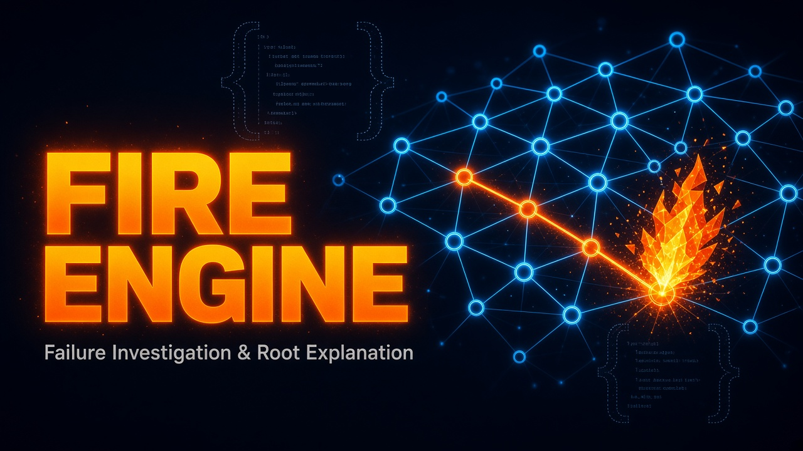

AI-assisted incident response that reasons over **payload shape** (never raw field
values) and the **process path** a request walked — which services, spans, and
changes it hit — then ranks **why it may have failed**, and posts a readable Slack message.

Existing IR tools are weak at connecting what the payload *looked like* with which path
through the system it took. FIRE ENGINE is built for that gap.

FIRE knows no watched system. Onboarding one means writing a YAML file
(`config/systems/<system>.yml`) from the template; every source kind, manifest format, and
trigger is a generic port that the YAML configures.

## Architecture

Hexagonal, with a strict dependency rule:

- `fire/core/` — domain, ports, and services. **Zero knowledge of concrete
  watched systems and zero infra deps** (only `pydantic` and the standard library).
- `fire/adapters/` — concrete port implementations (sources, manifests, shapes,
  catalogs, reasoners, narrators, notifiers, webhooks). Imports `core`.
- `fire/apps/` — runnable apps: the incident engine (the *body*) and the tentacle.
  Imports both.
- `config/systems/` — one YAML per watched system; all per-system variability
  lives here, never in code. It declares decisions (Slack channel id, manifest
  location, sources, policy exceptions, triggers); what the system contains is discovered
  from its manifest, never listed by hand. The repo ships only `_template.yml`.

```
apps  --imports-->  adapters  --imports-->  core        (never the other way)
```

### Body and tentacle

The **tentacle** (`python -m fire.apps.tentacle --system <system>`) runs next to a watched
system. It reads the sources the system's YAML declares, turns each payload into a shape and
a fingerprint, and sends only those, with attribute-free spans, to the body. Source kinds:

| Kind | Reads |
|------|-------|
| `replay` | `.json` / `.jsonl` files or a directory, once |
| `kinesis` | A Kinesis data stream, per region |
| `dynamodb_stream` | A DynamoDB table's stream, per region (also outcome sources such as an outbox of abandoned work) |
| `sns_fanout` | An SNS topic, through a FIRE-owned SQS queue subscribed to it |
| `http_proxy` | Inbound HTTP, as a reverse proxy in front of a service, with route templates from its OpenAPI document |
| `otlp` | OTLP/HTTP JSON spans from an OpenTelemetry collector |
| `s3_capture` | Request and response pairs a system's clients write to a bucket, joined to their spans |

The **body** (`python -m fire.apps.incident_engine`) stores observations, learns baselines and
paths, raises triggers (shape drift, path drift, 5xx bursts, DLQ attribution, incident.io
webhooks), correlates them into incidents, and diagnoses each one.

### Pipeline

Alert / ingest returns **202 at T=0**; diagnosis runs in background. Target: calibrated
possibilities in under 30 seconds.

1. **Correlate** — collapse a system's triggers inside a window into one incident.
2. **Assemble dossier** — shape drift, process path, change timeline, dependency health,
   visibility gaps, runbooks. Collectors fan out concurrently with per-tier budgets;
   missing evidence is declared `MISSING`, never invented.
3. **Reason** — System One over the dossier → calibrated possibility distribution.
4. **Narrate** — the Narrator turns the decision into Slack prose.
5. **Notify** — console locally; Slack when configured.

| Tier | Meaning | Default budget |
|------|---------|----------------|
| `TIER_0` | Internal reads (baseline, change ledger, visibility, deps) | ~300 ms |
| `TIER_1` | External pulls (vendor APIs / deep window capture) | ~3000 ms |
| `TIER_2` | Bonus context (runbook search / RAG) | ~1500 ms |

### Reasoner contract (non-negotiable)

- Input: **shape-only** payload evidence + **process path** (services/spans/changes).
  No raw field values.
- Engine: **System One**, a fast calibrated model, not a full generative LLM on the happy path.
  - Primitives: `choice` / `score` / `noul` over the dossier.
  - Output: **dynamic calibrated possibilities** (distribution + confidence), not
    prose root-cause. Option sets for `choice` can be built per incident from the
    path/hypotheses.
  - `noul` is the privacy gate when evidence is insufficient or unsafe to score.
- Cascade: System One first → low confidence → human and/or optional generative LLM
  escalation. Generative LLM is **not** the default reasoner.

### Narrator contract (non-negotiable)

The reasoner **decides**; the **Narrator** only writes readable prose for Slack.

- Input: the decision (possibilities + confidence) + shape/path fragments already in the
  dossier. **No raw payload values.**
- Output: coherent channel message. Must **not** invent a root cause, raise
  confidence, or introduce facts absent from the decision/dossier.

## Current state

v0 runs end to end with stubs behind the ports: the `echo` reasoner and a local template
narrator. Next: a System One reasoner adapter over HTTP (`FIRE_SYSTEMONE_BASE_URL`), an
OpenAI-compatible Narrator (`FIRE_NARRATOR_*`; keys never live in the repo), and the
feedback loop.

## Development

Requires Python 3.13+ and [uv](https://docs.astral.sh/uv/).

```bash
make install
make fmt
make lint
make test
make run                # local engine on :8000
```

Copy `.env.example` to `.env` and set `FIRE_API_TOKEN`. `dev/` holds local tooling for
recording scrubbed fixtures and replaying drift corpora into a running body (`dev/README.md`).

### Onboarding a system

```bash
cp config/systems/_template.yml config/systems/acme.yml   # set system: acme, then decide
make run                                                  # the body loads and validates it
uv run python -m fire.apps.tentacle --system acme --source work-unit-samples
```

Every env var the YAML names (`*_env`) goes into `.env`; an unset one makes the tentacle skip
that source and say so. Tests use the synthetic example system `acme` and its fixtures under
`tests/fixtures/acme/`.

## HTTP API

Every endpoint except `/health` and the incident.io webhook requires the `X-FIRE-Token`
shared secret: missing/invalid → `401`; `FIRE_API_TOKEN` unset on the server → `503`.
There is no fail-open mode.

| Method | Path | Does |
|--------|------|------|
| `GET` | `/health` | Liveness |
| `POST` | `/v0/diagnose` | Submit a `manual` incident; `422` if the client fingerprint of a `shape` differs from the recomputed one |
| `POST` | `/v0/observations` | Ingest shape and span observations; returns accepted / duplicate / rejected counts |
| `GET` | `/v0/systems/{system}/streams` | Baselines, counts, and open shape drift per stream key |
| `GET` | `/v0/systems/{system}/paths` | Open flows, counters, and one learned path per entry operation |
| `GET` | `/v0/systems/{system}/coverage` | Manifest events and OpenAPI routes never observed |
| `GET` | `/v0/systems/{system}/dlq` | Abandoned work units joined to their fingerprints |
| `POST` | `/v0/webhooks/incident-io` | incident.io webhooks, verified by signature; `503` while the secret is unset |

## Contributing

Nothing particular to a real watched system is committed here: no system YAML of a real
system, and no recordings or fixtures taken from one.
